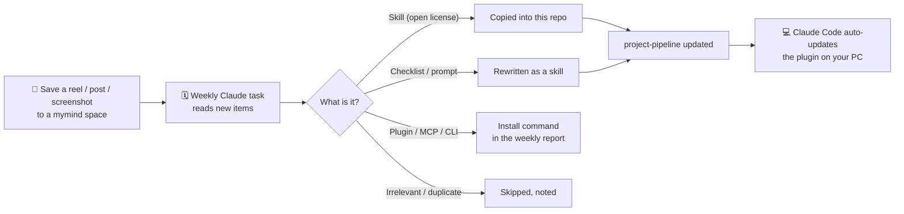

# claude-auto-kit

**Save it, forget it — Claude installs it.** A self-updating Claude Code plugin: you save AI tips (Instagram reels, TikToks, posts, screenshots) into [mymind](https://mymind.com) while scrolling, and once a week Claude goes through them, turns the useful ones into skills, and wires them into a `project-pipeline` skill that runs at the start of every project.

No more "saved 40 reels about Claude skills, installed none of them".



## How it works

1. **Capture.** Whenever you see something useful — a reel about a design skill, a security checklist, a GitHub repo — share it to a dedicated space in mymind (e.g. "AI"). mymind stores the link and writes an AI summary of the content.
2. **Weekly check.** A scheduled Claude task reads every item in that space that isn't tagged `claude-checked` yet. It works from mymind's summary, the tags and screenshots, plus web search and GitHub, to find out which tool or skill the post is about. It does not scrape Instagram or TikTok.
3. **Sort and act.**
   - Skills with an open license (MIT, Apache-2.0 …) are copied into [`plugins/auto-kit/skills/`](plugins/auto-kit/skills) — Markdown only, no scripts.
   - Checklists and prompts from posts are rewritten as skills in Claude's own words.
   - Plugins, MCP servers and CLI tools are never added automatically, because they run code on your machine. They show up as ready-to-paste commands in the weekly report.
4. **Wire it up.** Every new skill is added to [`project-pipeline`](plugins/auto-kit/skills/project-pipeline/SKILL.md) — either inside the phase where it belongs or in its "Extra skills" table.
5. **Ship it.** The task validates the plugin, commits to `main`, tags the mymind items `claude-checked` with a short note, and sends you a report: what was added, what was skipped and why, and what's left for you to do.
6. **Use it.** Claude Code auto-updates the plugin. Start any project and `project-pipeline` picks the skills that fit it — and only those.

## What `project-pipeline` does

A fixed sequence of phases for web, UI, 3D and video projects. Claude classifies the project, says which phases it will run and which it skips, then goes:

| Phase | What happens | Skills it pulls in |
|---|---|---|
| 0 Classify | Project type, plan, checkpoint | `brainstorming`, `writing-plans` (superpowers) |
| 1 Style | Concrete named style, fonts, colors | `ui-ux-pro-max`, `hallmark` |
| 2 DESIGN.md | Design system file for the project | getdesign.md / awesome-design-md |
| 3 Build | Realistic copy, sensible stack | `design-taste-frontend`, `impeccable`, `emil-design-eng`, `humanizer`, `test-driven-development` |
| 4 Motion | Animation only where it helps | `animate`, `apple-design`, `animation-performance` |
| 5 Test | Screenshots at 3 widths, edge cases, review, security | `playwright-cli`, `break-ui`, `web-design-guidelines`, `web-security-checklist` |
| 6 Polish | Audits and fixes | `impeccable`, `hallmark audit`, `find-animation-opportunities` |
| 7 3D asset | Image → procedural Three.js model | `img2threejs` |
| 8 Video | Storyboard first, then render | motion graphics skill, Remotion |

Skills that don't own a phase sit in an "Extra skills" table that Claude checks for every project.

## What's in the plugin

| Skill | What it's for | Source |
|---|---|---|
| `project-pipeline` | The orchestrator above | this repo |
| `web-security-checklist` | Pre-launch security review for AI-built web apps | this repo |
| `hallmark` | Anti-"AI slop" page structure, themes and audits | [nutlope/hallmark](https://github.com/nutlope/hallmark) |
| `humanizer` | Removes AI writing patterns from text | [blader/humanizer](https://github.com/blader/humanizer) |
| `web-design-guidelines` | UI review against Vercel's Web Interface Guidelines | [vercel-labs/agent-skills](https://github.com/vercel-labs/agent-skills) |
| `apple-design` | Apple-style fluid, physical motion for the web | [emilkowalski/skill](https://github.com/emilkowalski/skill) |
| `emil-design-eng` | UI polish and component details | [emilkowalski/skill](https://github.com/emilkowalski/skill) |
| `animate` | Building a single animation the right way | [emilkowalski/skill](https://github.com/emilkowalski/skill) |
| `animation-performance` | Keeping animations inside the frame budget | [emilkowalski/skill](https://github.com/emilkowalski/skill) |
| `find-animation-opportunities` | Where motion is missing — and where it isn't | [emilkowalski/skill](https://github.com/emilkowalski/skill) |
| `improve-animations` | Audit and plan for existing motion code | [emilkowalski/skill](https://github.com/emilkowalski/skill) |
| `review-animations` | Strict motion review (run it yourself) | [emilkowalski/skill](https://github.com/emilkowalski/skill) |
| `break-ui` | Stress-test UI with worst-case data | [emilkowalski/skill](https://github.com/emilkowalski/skill) |
| `pick-ui-library` | Picks a library for a frontend task (run it yourself) | [emilkowalski/skill](https://github.com/emilkowalski/skill) |

`project-pipeline` also calls skills from separately installed plugins and skills — see [Prerequisites](#prerequisites). If one is missing, it says so and carries on.

## Prerequisites

**To just use the plugin:**

- [Claude Code](https://code.claude.com) with the `claude` CLI and [git](https://git-scm.com) installed (git is only used by Claude Code to fetch the plugin)
- Recommended companions that `project-pipeline` uses when present:
  - plugins: `superpowers`, `ui-ux-pro-max`, `diagram-design`
  - skills: `design-taste-frontend`, `impeccable`, `playwright-cli`, `img2threejs`, `remotion-best-practices`, a motion graphics skill

**To run your own self-updating copy:**

- A [mymind](https://mymind.com) account. There's a free plan with a card limit (100 cards at the time of writing — check [mymind's pricing](https://mymind.com/pricing)); paid plans remove the limit.
- A Claude plan with scheduled tasks and connectors, and the **mymind connector** enabled in Claude (Settings → Connectors).
- A GitHub account, with Claude's GitHub access granted to your copy of this repo (push access).

## Install

```powershell
claude plugin marketplace add DerHeimer/claude-auto-kit
claude plugin install auto-kit@auto-kit
```

Turn on auto-update so new skills arrive by themselves — add this to `~/.claude/settings.json` (Windows: `C:\Users\<you>\.claude\settings.json`):

```json
"extraKnownMarketplaces": {
  "auto-kit": {
    "source": { "source": "github", "repo": "DerHeimer/claude-auto-kit" },
    "autoUpdate": true
  }
}
```

Make Claude run the pipeline automatically — add this line to your `CLAUDE.md`:

```text
For every new project (website, web app, dashboard, 3D scene, motion video), start by loading the auto-kit:project-pipeline skill and follow its phases.
```

Optional companions:

```powershell
claude plugin marketplace add anthropics/claude-plugins-official
claude plugin install superpowers@claude-plugins-official
claude plugin marketplace add nextlevelbuilder/ui-ux-pro-max-skill
claude plugin install ui-ux-pro-max@ui-ux-pro-max-skill
claude plugin marketplace add cathrynlavery/diagram-design
claude plugin install diagram-design@diagram-design
```

## Set up your own

1. **Copy the repo** to your account (fork or "Use this template") and change `owner`/`repository` in [`.claude-plugin/marketplace.json`](.claude-plugin/marketplace.json) and [`plugin.json`](plugins/auto-kit/.claude-plugin/plugin.json).
2. **Create a space** in mymind for your finds (e.g. "AI") and connect mymind to Claude.
3. **Schedule the weekly check.** Take the prompt from [`docs/weekly-check-prompt.md`](docs/weekly-check-prompt.md), fill in the placeholders, and schedule it in Claude. The task needs push access to your repo — if a fresh scheduled session can't get it, run the check as a weekly reminder in a chat that has the repo attached (the prompt schedules its own next run).
4. **Install** your copy as above, using your repo name.

## Safety model

- Only Markdown skills land in the repo automatically. Hooks, MCP servers, `bin/` executables and scripts never do — those come as commands you decide to run.
- Every candidate is checked for maintainer, activity, license, and for instructions that would push Claude to leak data, ignore rules or run code unasked.
- Offensive security tools are noted, never added.
- The weekly task never executes anything from a third-party repository.
- Social media pages are not scraped; the content comes from mymind's own summary and public sources.

## Limitations

- If a post doesn't name the tool and mymind's summary doesn't either, the item is tagged `claude-unclear` and the report asks you which tool was meant.
- Skills without a license that allows redistribution are not copied; you get the install command instead.
- Two skills (`review-animations`, `pick-ui-library`) are designed to run only when you invoke them, e.g. `/auto-kit:review-animations`.

## License

MIT for everything written for this repo — see [LICENSE](LICENSE). Copied skills keep their original licenses, listed with full text in [THIRD_PARTY_NOTICES.md](THIRD_PARTY_NOTICES.md).
